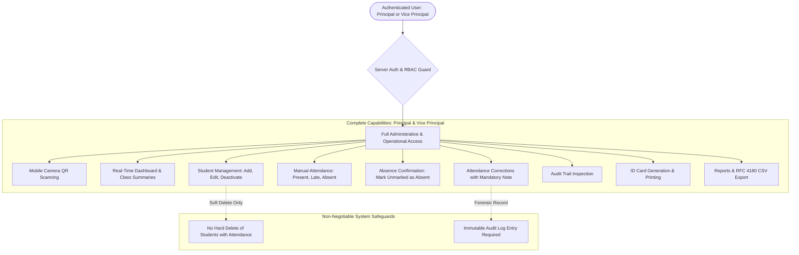
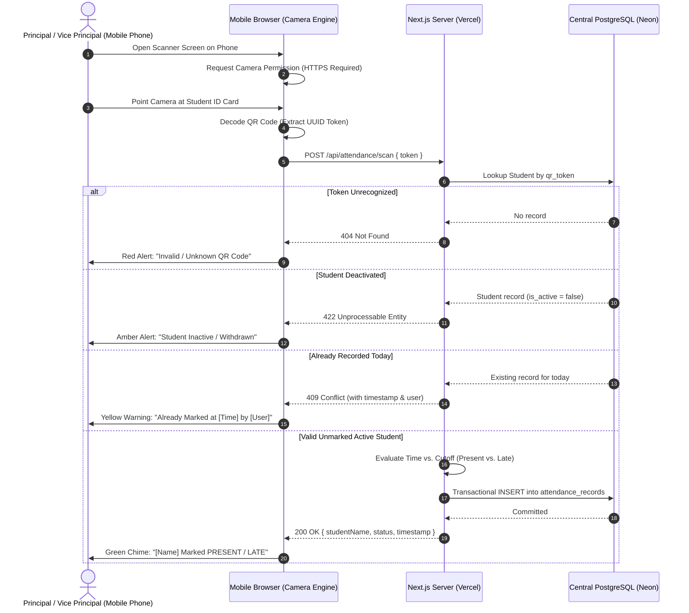
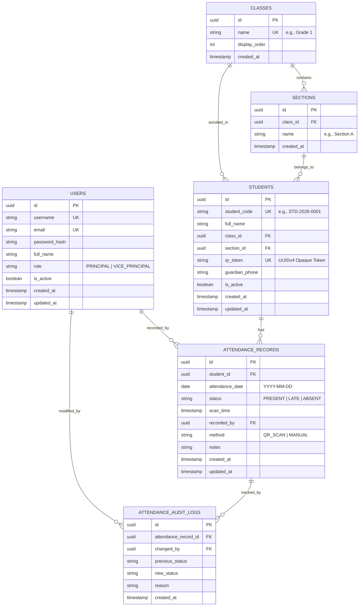

# Product Requirements Document (PRD)
## NiceAttend — School QR-Code Attendance System

**Document Version:** 1.4.0  
**Status:** Technology Stack & Architecture Documented (Awaiting Implementation Sign-Off)  
**Author:** Senior Software Architect & Product Requirements Analyst  
**Target Organization:** Nice School System  
**Initial Capacity:** ~500 Students (Single School Campus)  
**Target Device Access:** Mobile Phones of Principal & Vice Principal  
**Date:** October 2026  

---

## 1. Product Overview

### 1.1 Purpose & Problem Statement
Nice School System requires an efficient, foolproof, and accountable digital attendance workflow for approximately 500 students. Traditional paper registers and manual roll calls are slow, susceptible to clerical errors, delay administrative visibility, and consume valuable morning instructional time.

**NiceAttend** provides a streamlined, secure, web-based QR-code attendance management application designed for immediate mobile operation. Each student is issued a durable ID card bearing an opaque, secure QR code. Attendance is recorded directly by school leadership—the **Principal** and **Vice Principal**—using their personal mobile phone cameras at campus entry points or in classrooms.

The application connects to a **shared central database**, ensuring both administrators see consistent, instantaneous updates across their devices. NiceAttend enforces server-side duplicate prevention, records precise scan timestamps, distinguishes unmarked students from confirmed absences, allows authorized manual adjustments with full audit tracking, and provides real-time dashboards and exportable reports.

### 1.2 Target Users & Confirmed Device-Access Profile
- **Active User Population (Initial Version):**
  - **Principal:** Full administrative and operational mobile access.
  - **Vice Principal:** Full administrative and operational mobile access.
  - **Other Teachers / General Staff:** Explicitly **out of scope** for mobile access in this initial version. (Teacher access and individual classroom accounts are deferred to a subsequent release).
- **Device & Operating Environment:**
  - Modern smartphones operated by the Principal and Vice Principal (iOS Safari, Android Chrome).
  - Both users access the system remotely over cellular (4G/5G) or school campus Wi-Fi.
  - Standard office printers accessible via desktop/laptop browser for printing student ID cards (A4 cardstock) and daily attendance summaries.
- **Central Shared State:**
  - Both mobile devices interface with a single centralized cloud database over secure HTTPS.
  - A scan recorded by the Vice Principal at a secondary gate is immediately reflected on the Principal's dashboard at the primary gate upon data refresh.

### 1.3 Scope: Inclusions & Exclusions

#### In Scope (Initial Demonstration & Production Pilot)
- Dedicated mobile web application secured for Principal and Vice Principal.
- Centralized, shared database ensuring instantaneous data consistency across both mobile devices.
- Student lifecycle management (Add, Edit, View, Deactivate) with grade and section associations.
- Secure, opaque QR code token generation (zero personal student data stored in the QR symbol).
- Print-ready student ID card layout (A4 multi-card sheet format with cutting guides, prominently displaying the school name: **Nice School System**).
- In-browser mobile camera scanning engine with instant audio, haptic, and visual feedback.
- Strict server-side duplicate-scan prevention and concurrent scan resolution.
- Core attendance statuses: `PRESENT`, `LATE`, `ABSENT`, and clear representation of `UNMARKED`.
- Manual attendance entry fallback and authorized attendance correction workflow with an immutable audit log.
- Mobile-optimized real-time dashboard displaying active counts, present/late/absent tallies, and attendance percentage.
- Historical attendance reporting with class, section, date filters, printable views, and CSV export.
- Zero-budget deployment on Vercel Hobby + Neon Serverless PostgreSQL with mandatory HTTPS for camera access.

#### Out of Scope (Explicitly Excluded from Initial Version)
- Mobile access for teachers or teaching assistants (deferred to future phase).
- Multi-school / multi-tenant SaaS architecture.
- Biometric hardware integration (fingerprint, facial recognition).
- SMS or WhatsApp automated notification gateway (deferred to avoid recurring API messaging charges).
- Student or Parent self-service accounts.
- Tuition fee tracking, gradebook, or timetable scheduling modules.
- Enterprise microservices, dedicated cache layers, or complex message brokers.

### 1.4 Success Criteria & Measurable Goals
1. **Scanning Speed:** End-to-end processing time under 500 milliseconds per scan on standard 4G mobile connections.
2. **Data Consistency:** Zero data divergence between Principal and Vice Principal devices; 100% real-time reflection of shared state.
3. **Data Integrity:** Exactly zero duplicate attendance records permitted per student per calendar date/session.
4. **Mobile Usability:** Quick login and launch of scanner viewfinder within 10 seconds on mobile browsers.
5. **Accountability:** 100% auditability for any manual record modification or status override.
6. **Zero Infrastructure Cost:** Operational on well-architected free-tier infrastructure without compromising security or camera HTTPS prerequisites.

---

## 2. User Roles & Permissions

NiceAttend enforces strict Server-Side Role-Based Access Control (RBAC). In accordance with confirmed leadership decisions, **both the Principal and Vice Principal have full administrative access** to all features, records, and management capabilities, backed by comprehensive audit logging and integrity safeguards.



### 2.1 Role Matrix (Confirmed Equal Co-Administrators)

| Capability / Action | Principal | Vice Principal | Security Safeguards & Enforcement |
| :--- | :---: | :---: | :--- |
| **Mobile QR Code Scanning** | Yes | Yes | Identical sub-second camera processing on both phones |
| **Real-Time Live Dashboard** | Yes | Yes | Shared live state from central Neon database |
| **Class & Section Summaries** | Yes | Yes | Filterable campus-wide and by class/section |
| **Add & Edit Student Details** | Yes | Yes | Server validation via Zod; unique code check |
| **Deactivate Student Record** | Yes | Yes | **Safeguard:** Soft deactivation only (`is_active = false`) |
| **Permanent Hard Delete of Records** | **NO** | **NO** | **Strict Safeguard:** Prohibited by database foreign keys |
| **Manual Attendance Fallback** | Yes | Yes | Allows marking Present, Late, or Absent manually |
| **Confirm Unmarked as Absent** | Yes | Yes | Explicit action; unmarked never automatically marked absent |
| **Correct Attendance Status** | Yes | Yes | **Safeguard:** Reason mandatory; logged to audit trail |
| **View Audit Trail Logs** | Yes | Yes | Full forensic transparency for all corrections |
| **Generate & Print QR ID Cards** | Yes | Yes | Formatted for desktop/laptop printing on A4 cardstock |
| **Export Reports (CSV / Print)** | Yes | Yes | RFC 4180 CSV download & print stylesheets |
| **Manage Staff Credentials / Passwords** | Yes | Yes | Argon2id hashing; session invalidation on reset |

### 2.2 Security Safeguards & Enforcement Rules
1. **Permanent Deletion Prohibited:** Neither administrator can permanently delete student records or historical attendance rows. When a student leaves the school, they are deactivated (`is_active = false`), preserving all historical attendance data for compliance and reporting while preventing future scans.
2. **Mandatory Audit Logging for Corrections:** Any status change made after an initial scan or manual entry requires selecting a reason and automatically logs the user ID, timestamp, prior status, new status, and justification note in `attendance_audit_logs`.
3. **Server-Side Verification:** Permissions and authentication tokens are validated on every API route and server mutation. Hiding UI elements is never used as a substitute for server-level authorization.

---

## 3. Student & Class Management

### 3.1 Student Information & Privacy Minimization
To uphold data privacy and minimize operational overhead, NiceAttend collects and stores only data strictly necessary for attendance management:

- **Student Code (`student_code`):** Human-readable unique registration or roll number (e.g., `STD-2026-0042`). Unique across the school.
- **Full Legal Name (`full_name`):** Student's first and last name.
- **Class / Grade (`class_id`):** Enrolled academic grade level (e.g., Grade 1 through Grade 10).
- **Section (`section_id`):** Specific section (e.g., Section A, Section B).
- **Status (`is_active`):** Boolean indicator (`true` = enrolled, `false` = withdrawn/inactive).
- **Guardian Contact Phone Number (`guardian_phone`):** Optional contact number for attendance discrepancy checks.
- **QR Token (`qr_token`):** High-entropy, opaque UUID string linked to the student.
- **Timestamps:** `created_at` and `updated_at`.

*Explicitly Excluded:* National identity numbers (CNIC/B-Form/SSN), home street addresses, medical data, financial history, or sensitive personal demographics.

### 3.2 Duplicate Prevention & Lifecycle
- **Duplicate Prevention:**
  - Unique constraint on `student_code` at the database level.
  - Server-side pre-check preventing two students from sharing the same student code.
- **Deactivation Lifecycle:**
  - Deactivating a student sets `is_active = false`.
  - Inactive students are immediately blocked from scanning (scanner displays `"Student Inactive / Withdrawn"`).
  - Inactive students are excluded from active daily attendance rosters and dashboard totals, but remain fully accessible in historical date reports.

---

## 4. QR Code & Student ID Card System

### 4.1 Token Security & Opaque Identifiers
- **Zero PII Exposure:** The physical QR code **must never** encode student names, roll numbers, phone numbers, or database IDs.
- **Opaque Cryptographic Token:** The QR code encodes exclusively a UUIDv4 token:
  $$\text{Payload} = \texttt{f47ac10b-58cc-4372-a567-0e02b2c3d479}$$
- **Server Validation:** The server resolves the token against the centralized database. If a student card is lost, an administrator generates a new token with one click; the old card is immediately invalidated.

### 4.2 Printable Student ID Card Specification
The application includes a desktop/laptop-friendly print view (`@media print`):
- **Card Format:** Multi-card layout optimized for standard A4 cardstock sheets (8 cards per sheet: 2 columns $\times$ 4 rows with cutting lines). *(Card paper and physical printing specifications remain an unconfirmed working assumption pending campus printer confirmation).*
- **Mandatory Prominent School Name Display:** Every generated and printed student ID card must prominently display the official school name:
  $$\textbf{Nice School System}$$
  The school name must be placed as the primary top header on every card in bold, legible typography so that it is clearly and immediately readable on physical printouts.
- **Card Elements (Preserved Layout):**
  1. **School Header (Prominent & Clearly Readable):** **Nice School System**
  2. **Student Full Name:** Prominent student legal name.
  3. **Student Code / Roll Number:** Unique identifier (e.g., `STD-2026-0042`).
  4. **Class & Section:** Enrolled grade and section (e.g., `Grade 5 - Section A`).
  5. **High-Contrast QR Code:** Minimum $25 \times 25\text{ mm}$ print size, Error Correction Level `M`, encoding exclusively the opaque UUIDv4 token.
  6. **Return Address Footer:** Property and return notice for lost cards.

---

## 5. Attendance Workflow



### 5.1 Mobile Camera Scanning Engine
- **In-Browser WebRTC:** Leverages `navigator.mediaDevices.getUserMedia` directly inside mobile Safari or Chrome without requiring a native app store download.
- **Client Debounce:** Built-in 2.5-second cooldown on the same token to prevent accidental multi-scan loops when holding a card in front of the lens.
- **Auditory & Haptic Feedback:**
  - **Success:** High-pitched chime + mobile haptic vibration + green border with student details.
  - **Duplicate Scan:** Double-click audio + yellow alert card showing when and by whom the student was already marked.
  - **Invalid / Inactive:** Low error tone + red/amber modal alert.

### 5.2 Status Definitions & Explicit Absence Rule
- **`UNMARKED` (Default):** Every active student starts the day in the `UNMARKED` state (no attendance record exists yet).
- **`PRESENT`:** Student scanned or manually recorded before the late cutoff.
- **`LATE`:** Student scanned or manually recorded after the late cutoff.
- **`ABSENT` (Confirmed Absence):**
  > [!IMPORTANT]
  > **Explicit Absence Confirmation Rule:** The system **never automatically classifies unscanned students as Absent** without explicit school approval. Unmarked students remain distinctly labeled as `UNMARKED`. Confirmation of `ABSENT` occurs only when the Principal or Vice Principal reviews the unmarked roster and explicitly executes **"Confirm Remaining Unmarked as Absent"** or marks an individual student absent manually.

### 5.3 Schedule, Timezone & Cutoff Assumptions
- **Timezone Assumption:** `Asia/Karachi` (UTC+5). *(Unconfirmed working assumption; subject to school verification).*
- **School Schedule Working Assumptions (Configurable):**
  - Campus Gate Opens: `07:30 AM`
  - On-Time Cutoff: `08:00 AM`
  - Late Threshold: `08:01 AM – 08:30 AM` (Marked `LATE`)
  - Gate Closure / Review Window: `09:15 AM` (Recommended time for absence confirmation).
  *(Unconfirmed working assumptions; official bell schedule to be confirmed by school management).*

### 5.4 Concurrency & Duplicate Prevention on Shared Database
- **Integrity Rule:** Database-level unique constraint:
  $$\texttt{UNIQUE(student\_id, attendance\_date)}$$
- **Simultaneous Scans:** If both administrators scan the same student at separate gates at the exact same second:
  1. Both requests reach the centralized Neon database within milliseconds.
  2. The unique constraint guarantees that exactly one transaction succeeds.
  3. The second transaction is cleanly caught by the server, returning a friendly HTTP 409 response: `"Already marked by [User] at [HH:MM:SS]"`. No duplicate records are created.

### 5.5 Manual Fallback & Audit Corrections
- **Manual Fallback:** If a student forgets their card, either administrator can search the student on their phone and manually mark them `PRESENT`, `LATE`, or `ABSENT`.
- **Authorized Corrections:** If a status needs alteration, either administrator can update the record. The system mandates a brief justification note and records the event in `attendance_audit_logs`.

---

## 6. Dashboard & Reporting

### 6.1 Real-Time Mobile Dashboard
The mobile dashboard provides an instantaneous, unified snapshot of school attendance for the day:

$$\text{Total Active Enrolled} = \text{Count of all enrolled students with } \texttt{is\_active = true}$$

$$\text{Present Count} = \text{Count of students with status } \texttt{PRESENT}$$

$$\text{Late Count} = \text{Count of students with status } \texttt{LATE}$$

$$\text{Confirmed Absent Count} = \text{Count of students with status } \texttt{ABSENT}$$

$$\text{Unmarked Count} = \text{Total Active} - (\text{Present} + \text{Late} + \text{Absent})$$

$$\text{Attendance Rate (\%)} = \left( \frac{\text{Present} + \text{Late}}{\text{Total Active}} \right) \times 100$$

*(Unmarked students are clearly separated from confirmed absences in both counters and class breakdown tables).*

### 6.2 Filtering, Export & Print Capabilities
- **Filters:** Date picker, Class/Grade dropdown, Section dropdown, Status filter (`ALL`, `PRESENT`, `LATE`, `ABSENT`, `UNMARKED`).
- **Student History:** 30-day and term attendance records per student.
- **CSV Export:** Standard RFC 4180 CSV export download available with all relevant fields.
- **Print Optimization:** Print stylesheet (`@media print`) hides navigation elements and produces formal daily attendance sheets suitable for physical school archiving.

---

## 7. Security & Privacy Architecture

### 7.1 Server-Side Authentication & Session Security
- **Credential Storage:** User passwords hashed using **Argon2id** (or `bcrypt` with cost factor $\ge 12$).
- **Session Tokens:** Secure, HTTP-only, `SameSite=Lax`, `Secure` session cookies. No credentials or auth tokens stored in insecure mobile `localStorage`.
- **Brute-Force Throttling:** Strict rate limiting on login routes (maximum 5 attempts per IP/username per 15 minutes).

### 7.2 Mandatory HTTPS for Mobile Camera Access
> [!CAUTION]
> **Technical Prerequisite:** Modern mobile operating systems (iOS and Android) strictly enforce that `navigator.mediaDevices.getUserMedia` is only accessible in secure contexts (**HTTPS**). Plain HTTP connections will fail to activate the camera on remote mobile devices. Hosting Option A provides automated, valid SSL/TLS certificates out of the box.

### 7.3 Data Minimization & Input Validation
- **Input Validation:** All incoming payloads are strictly validated on the server using Zod schemas.
- **SQL Injection Prevention:** 100% parameterized queries via Prisma ORM.
- **Log Sanitation:** Passwords, tokens, and personal phone numbers are strictly redacted from application logs.

---

## 8. Technology Stack & Zero-Budget Deployment Architecture (Hosting Option A)

In accordance with stakeholder approval, **Hosting Option A** is confirmed as the technical and deployment baseline. The architecture is intentionally designed for a single school (~500 students) to minimize complexity, eliminate recurring infrastructure costs, and ensure rock-solid data consistency across mobile devices.

```
                    [ Principal Mobile ]       [ Vice Principal Mobile ]
                             \                    /
                              \  HTTPS / WebRTC  /
                               ▼                ▼
                     +------------------------------------+
                     |  Vercel Edge Network (Free Hobby)  |
                     |  - Automatic SSL / TLS (HTTPS)     |
                     |  - Mobile-Optimized Asset Delivery |
                     +-----------------▲------------------+
                                       │
                                       ▼
                     +------------------------------------+
                     |  Next.js Full-Stack App (Server)   |
                     |  - React Server Components & Actions|
                     |  - Server-Side RBAC Guard Middleware|
                     |  - Attendance Engine (Debounce)    |
                     |  - QR Cryptographic Token Service  |
                     +-----------------▲------------------+
                                       │ Parameterized SQL over TLS (Neon Pooler)
                                       ▼
                     +------------------------------------+
                     |  Neon Serverless PostgreSQL (Free) |
                     |  - Central Shared Database         |
                     |  - 0.5 GB Storage (~30 yr for 500) |
                     |  - ACID Transactions & Uniqueness  |
                     |  - Foreign Key Integrity Rules     |
                     +------------------------------------+
```

### 8.1 Confirmed Technology Stack Specifications

| Layer / Capability | Exact Technology Choice | Architectural Justification for ~500 Students |
| :--- | :--- | :--- |
| **Full-Stack Framework** | **Next.js (v14+ App Router) & TypeScript** | Unifies frontend UI and backend API routes in a single, type-safe repository. Eliminates CORS overhead, allows shared types between client and server, and provides fast server-rendered views. |
| **Styling & Print** | **Tailwind CSS** | Utility-first styling optimized for high-performance mobile screens and precise print layouts (`@media print`) for student ID card sheets and daily attendance reports. |
| **Central Database** | **Neon Serverless PostgreSQL 16** | Cloud-native relational database with built-in connection pooling (`pgbouncer`), strict ACID transactions, and automated storage scaling. Free tier covers 30+ years of school attendance data. |
| **Object-Relational Mapping (ORM)** | **Prisma ORM (v5+)** *(Selected over Drizzle)* | **Why Prisma:**<br>1. *Declarative, Human-Readable Schema (`schema.prisma`):* Provides a single, self-documenting schema file matching the PRD data model 1:1, making maintenance intuitive for school IT staff.<br>2. *Built-In Visual Data Browser (`npx prisma studio`):* Gives school administrators a zero-code web interface to inspect and audit database rows directly without requiring third-party database GUIs.<br>3. *Bulletproof Concurrency & Transactions:* Built-in `prisma.$transaction()` guarantees atomic operations, ensuring simultaneous scans from separate mobile devices never corrupt records.<br>4. *Neon Connection Pooler Support:* Directly connects through Neon's connection pooler URL with native TLS. *(Drizzle was evaluated, but Prisma was chosen for its superior maintainability, visual tooling, and beginner-friendly developer experience).* |
| **Authentication & Sessions** | **Argon2id + HTTP-Only Encrypted Cookies** | Industry-standard password hashing using Argon2id. Sessions are signed and encrypted via high-entropy cookies (`iron-session` or standard Web Crypto HMAC-SHA256). Prohibits credentials in client `localStorage`. |
| **Server-Side Role Checks** | **Server Guard Middleware (`requireAdminAuth`)** | Every protected Server Action and API route verifies the session signature, queries the active status of the user, and confirms role authorization (`PRINCIPAL` or `VICE_PRINCIPAL`) on the server before executing mutations. |
| **QR Code Generation** | **`qrcode` (Node.js)** | Generates clean, crisp vector SVG and high-resolution PNG data URLs directly in the browser or on the server. Encodes exclusively the opaque UUIDv4 token with Error Correction Level `M`. Zero student PII. |
| **Mobile Camera Scanner** | **`html5-qrcode`** | Decodes QR codes client-side in the mobile browser canvas using `navigator.mediaDevices.getUserMedia`. Video frames stay on the phone; only the decoded opaque text token is sent over HTTPS to the server. Includes a 2.5-second debounce cooldown. |
| **Testing Suite** | **Vitest + Playwright** | **Vitest:** Fast, native TypeScript unit/integration testing for attendance algorithms, cutoff rules, and auth guards.<br>**Playwright:** End-to-end testing simulating mobile viewports (iOS Safari, Android Chrome), mock camera streams, and multi-user concurrency. |

### 8.2 Multi-User Mobile Live Sync Architecture
To ensure the Principal and Vice Principal have identical, up-to-date visibility from separate smartphones:

1. **Centralized Authority:** Both phones interact exclusively with the single Next.js application hosted on Vercel (`https://niceattend.vercel.app`) backed by the central Neon PostgreSQL database. No local device-only databases or offline splits are utilized.
2. **Secure HTTPS Tunnel:** Modern mobile browsers strictly mandate HTTPS for camera hardware access. Vercel provisions automated SSL/TLS certificates (Let's Encrypt), enabling secure WebRTC camera access on both phones.
3. **Instant Commit & Visibility:**
   - When the Vice Principal scans a student card at Gate B, the phone sends `POST /api/attendance/scan { token: "uuid-..." }`.
   - The server verifies the token and executes an atomic `INSERT` into `attendance_records` inside Neon PostgreSQL with `recorded_by = vice_principal_id`.
   - When the Principal at Gate A views or refreshes the mobile dashboard, Next.js server components read directly from the same Neon database. The newly recorded scan, updated class tallies, and recalculated attendance rates are immediately reflected.
4. **Collision Resolution:** If both administrators scan the same student at the exact same second, Neon's database constraint `UNIQUE(student_id, attendance_date)` guarantees that exactly one transaction succeeds. The second transaction triggers a handled conflict exception, returning an HTTP 409 response with the first scan's timestamp and operator name, preventing duplicate records without crashing.

### 8.3 Required Environment Variables
The application requires the following environment variables. In production, these are securely configured in the Vercel dashboard; in local development, they are defined in a `.env.local` file (which is strictly excluded from version control via `.gitignore`):

```bash
# ==========================================
# NiceAttend Environment Configuration Template
# ==========================================

# Neon Serverless PostgreSQL connection string (pooled connection for runtime queries)
DATABASE_URL="postgresql://[user]:[password]@[neon-hostname]/niceattend?sslmode=require&pgbouncer=true"

# Neon direct connection string (unpooled connection required for Prisma schema migrations)
DIRECT_URL="postgresql://[user]:[password]@[neon-hostname]/niceattend?sslmode=require"

# Cryptographic secret for signing and encrypting session cookies (min. 32 random characters)
SESSION_SECRET="e9b7a4f8c2d1e5a3b7c9d0f2e4a6b8c1d3e5f7a9b0c2d4e6f8a1b3c5d7e9f0a2"

# Public URL of the deployed application (used for secure cookie scoping and redirects)
NEXT_PUBLIC_APP_URL="https://niceattend.vercel.app"

# School campus operational timezone (unconfirmed working assumption; defaults to Asia/Karachi)
SCHOOL_TIMEZONE="Asia/Karachi"

# Node environment flag ('development' locally, 'production' on Vercel)
NODE_ENV="production"
```

### 8.4 Deployment Steps, Free-Tier Limits & Cost Analysis

#### Step-by-Step Zero-Budget Deployment Guide
1. **Database Setup (Neon):**
   - Register a free account at [neon.tech](https://neon.tech).
   - Create a new project named `niceattend-db` (Region: nearest to Pakistan/South Asia, e.g., `ap-southeast-1` or `eu-central-1`).
   - Copy the **Pooled Connection URL** (for `DATABASE_URL`) and the **Direct Connection URL** (for `DIRECT_URL`).
2. **Repository Setup (GitHub):**
   - Initialize a private Git repository for `NiceAttend` and push the project code.
3. **Application Deployment (Vercel):**
   - Register a free account at [vercel.com](https://vercel.com) using GitHub.
   - Import the `NiceAttend` repository.
   - In the project settings, add the required Environment Variables (`DATABASE_URL`, `DIRECT_URL`, `SESSION_SECRET`, `NEXT_PUBLIC_APP_URL`, `SCHOOL_TIMEZONE`).
   - Click **Deploy**. Vercel will build the Next.js application and issue an automated SSL certificate for `https://[project-name].vercel.app`.
4. **Initial Database Migration & Seed:**
   - Execute `npx prisma migrate deploy` to create all database tables, constraints, and indexes on Neon.
   - Execute `npx prisma db seed` to initialize the default Principal and Vice Principal accounts and default grade levels.

#### Free-Tier Limits & Operational Realities (Transparent Accounting)

| Provider & Resource | Free-Tier Allowance | Expected Usage for 500 Students | Safety Margin & Realities |
| :--- | :--- | :--- | :--- |
| **Vercel Hobby (Hosting)** | 100 GB bandwidth / month<br>100 GB-hours compute | $< 1\text{ GB}$ bandwidth / month<br>$< 2$ compute hours / month | Over **98% safety margin**. Extremely lightweight for 2 active administrators. |
| **Neon PostgreSQL (Storage)** | 0.5 GB (500 MB) storage | $\approx 15\text{ MB}$ per school year | 500 MB covers approximately **30+ years** of attendance history. |
| **Neon PostgreSQL (Compute)** | Shared vCPU with auto-suspend | Active primarily during morning arrival (07:30 – 09:30 AM) | **Cold-Start Reality:** Neon compute auto-suspends after 5 minutes of inactivity. The first scan of the morning may experience a 2–3 second delay while compute awakens. All subsequent scans execute in under 300 ms. |
| **Total Monthly Cost** | **$0.00 / month** | **$0.00 / month** | Operates indefinitely at zero cost. No credit card required. |

#### Disaster Recovery & Portability Safeguards
- **One-Click SQL/JSON Dump:** The dashboard includes an administrative "Export Database Backup" action allowing the Principal to download a complete local snapshot of student and attendance data at any time.
- **Portability:** Because Prisma provides database abstraction, if the school ever wishes to transition from Neon cloud to an on-premises desktop computer or a private VPS in the future, the application can switch database providers simply by updating the connection string, with zero codebase changes.

---

## 9. Data Model & Entity Specifications



### 9.1 Entity Schema Definitions

#### 1. `users`
Represents the administrative accounts (Principal and Vice Principal).
- `id` (UUID, Primary Key)
- `username` (VARCHAR(50), Unique, Not Null)
- `email` (VARCHAR(100), Unique, Not Null)
- `password_hash` (VARCHAR(255), Not Null)
- `full_name` (VARCHAR(100), Not Null)
- `role` (ENUM: `'PRINCIPAL'`, `'VICE_PRINCIPAL'`, Not Null)
- `is_active` (BOOLEAN, Default: `true`, Not Null)
- `created_at` (TIMESTAMP, Default: `NOW()`)
- `updated_at` (TIMESTAMP, Default: `NOW()`)

#### 2. `classes`
Represents grade levels.
- `id` (UUID, Primary Key)
- `name` (VARCHAR(50), Unique, Not Null, e.g., "Grade 5")
- `display_order` (INTEGER, Default: 0)
- `created_at` (TIMESTAMP, Default: `NOW()`)

#### 3. `sections`
Represents classroom sections within a grade.
- `id` (UUID, Primary Key)
- `class_id` (UUID, Foreign Key -> `classes.id` ON DELETE CASCADE, Not Null)
- `name` (VARCHAR(50), Not Null, e.g., "Section A")
- `created_at` (TIMESTAMP, Default: `NOW()`)
- *Constraint:* `UNIQUE(class_id, name)`

#### 4. `students`
Represents enrolled students.
- `id` (UUID, Primary Key)
- `student_code` (VARCHAR(30), Unique, Not Null, Index)
- `full_name` (VARCHAR(100), Not Null)
- `class_id` (UUID, Foreign Key -> `classes.id` ON DELETE RESTRICT, Not Null)
- `section_id` (UUID, Foreign Key -> `sections.id` ON DELETE RESTRICT, Not Null)
- `qr_token` (VARCHAR(64), Unique, Not Null, Index) — *Opaque UUID string*
- `guardian_phone` (VARCHAR(25), Nullable)
- `is_active` (BOOLEAN, Default: `true`, Not Null, Index)
- `created_at` (TIMESTAMP, Default: `NOW()`)
- `updated_at` (TIMESTAMP, Default: `NOW()`)

#### 5. `attendance_records`
Represents daily attendance entries.
- `id` (UUID, Primary Key)
- `student_id` (UUID, Foreign Key -> `students.id` ON DELETE RESTRICT, Not Null, Index)
- `attendance_date` (DATE, Not Null, Index) — *Stored in `YYYY-MM-DD` relative to local school timezone*
- `status` (ENUM: `'PRESENT'`, `'LATE'`, `'ABSENT'`, Not Null)
- `scan_time` (TIMESTAMP, Nullable)
- `recorded_by` (UUID, Foreign Key -> `users.id` ON DELETE RESTRICT, Not Null)
- `method` (ENUM: `'QR_SCAN'`, `'MANUAL'`, Not Null)
- `notes` (TEXT, Nullable)
- `created_at` (TIMESTAMP, Default: `NOW()`)
- `updated_at` (TIMESTAMP, Default: `NOW()`)
- *Integrity Constraint:* `UNIQUE(student_id, attendance_date)`

#### 6. `attendance_audit_logs`
Immutable forensic ledger of status modifications.
- `id` (UUID, Primary Key)
- `attendance_record_id` (UUID, Foreign Key -> `attendance_records.id` ON DELETE CASCADE, Not Null, Index)
- `changed_by` (UUID, Foreign Key -> `users.id` ON DELETE RESTRICT, Not Null)
- `previous_status` (VARCHAR(20), Not Null)
- `new_status` (VARCHAR(20), Not Null)
- `reason` (TEXT, Nullable)
- `created_at` (TIMESTAMP, Default: `NOW()`)

---

## 10. UI/UX Requirements (Mobile-First)

### 10.1 Mobile-First Interface
Because both primary users interact with NiceAttend exclusively on their smartphones, the interface is optimized for thumb-reach and one-handed operation:
- **Bottom Navigation Bar:** Fast access to `[Scan]`, `[Dashboard]`, `[Roster]`, and `[Reports]`.
- **Large Touch Targets:** Minimum 48px $\times$ 48px buttons for reliable outdoor tapping.
- **High-Contrast Viewport:** Clear reticle aiming box with torch/flashlight toggle button.
- **Audio & Haptic Confirmations:** Immediate physical vibration and clear tones so administrators can scan a rapid queue of students without constantly checking the screen.
- **Clean Color Badges:**
  - `PRESENT`: Emerald Green (`bg-emerald-600`)
  - `LATE`: Amber Yellow (`bg-amber-600`)
  - `ABSENT`: Rose Red (`bg-rose-600`)
  - `UNMARKED`: Slate Gray (`bg-slate-500`)

---

## 11. Testing Matrix & Acceptance Criteria

| Test ID | Feature / Area | Scenario / Action | Expected Result | Pass/Fail Criteria |
| :--- | :--- | :--- | :--- | :--- |
| **TC-MOB-01** | Mobile Camera | Open scanner on iOS Safari and Android Chrome via HTTPS | Camera initializes cleanly; video stream renders with reticle | Stream Active |
| **TC-MOB-02** | Camera Security | Attempt camera initialization over insecure HTTP | Blocked by browser; UI displays clear HTTPS requirement alert | Graceful Alert |
| **TC-SYNC-01** | Multi-User Sync | Vice Principal scans student on Phone 1; Principal views Phone 2 | Phone 2 dashboard displays updated record on next refresh | Data Consistent |
| **TC-CONC-01** | Concurrency | Both users scan same student at the exact same second | DB unique constraint catches collision; 1 success, 1 friendly conflict alert | Exactly 1 Record |
| **TC-AUTH-01** | Authentication | Principal and Vice Principal log in on mobile | Valid session cookie issued; redirected to mobile dashboard | HTTP 200 |
| **TC-SAFE-01** | Delete Safeguard | Attempt hard deletion of student with attendance history | Blocked by DB foreign key constraint; soft deactivation offered | HTTP 400 / 409 |
| **TC-STUD-01** | Student CRUD | Add, edit contact details, and deactivate student | Database updates; inactive student immediately rejected by scanner | HTTP 200 |
| **TC-QR-01** | QR Integrity | Decode printed QR symbol | UUIDv4 string decoded; contains zero plaintext student PII | Opaque UUID |
| **TC-SCAN-01** | QR Scanning | Scan valid active student before late cutoff | Attendance recorded as `PRESENT`; success chime sounds | HTTP 200 |
| **TC-SCAN-02** | Late Detection | Scan valid active student after late cutoff | Attendance recorded as `LATE`; amber alert displayed | HTTP 200 (LATE) |
| **TC-SCAN-03** | Duplicate Scan | Re-scan student card already marked today | Second scan rejected; UI displays "Already marked at [Time]" | HTTP 409 / Handled |
| **TC-ABS-01** | Bulk Absences | Trigger "Confirm Remaining Unmarked as Absent" | Only currently unmarked students converted to `ABSENT` | HTTP 200 |
| **TC-CORR-01** | Audit Log | Alter attendance status from Late to Present with note | Record updated; immutable row inserted in `attendance_audit_logs` | Audit Row Created |
| **TC-REP-01** | Math Consistency | Calculate metrics: Total, Present, Late, Absent, Unmarked | $\text{Present} + \text{Late} + \text{Absent} + \text{Unmarked} \equiv \text{Total Active}$ | 100% Exact Match |
| **TC-EXP-01** | CSV & Print | Trigger CSV download and print view | Valid CSV generated; print layout formats cleanly; ID cards prominently display "Nice School System" | Clean Output |

---

## 12. Unresolved Decisions & Configurable Assumptions

The following operational items remain pending verification from school management:

1. **School Operational Timezone:**
   - *Current Working Assumption:* `Asia/Karachi` (UTC+5).
   - *Status:* Unconfirmed assumption; pending confirmation from Nice School System.
2. **School Arrival Timings & Late Cutoff Policy:**
   - *Current Working Assumption:* Gate opens at `07:30 AM`; on-time arrival cutoff is `08:00 AM`; late arrival threshold is `08:01 AM – 08:30 AM`; gate closure at `09:15 AM`.
   - *Policy Safeguard:* Unscanned students will **never be automatically marked absent** at cutoff without explicit school policy approval.
   - *Status:* Unconfirmed assumption; pending official bell schedule from Nice School System.
3. **Physical ID Card Printing Format:**
   - *Current Working Assumption:* Standard A4 cardstock sheets (8 cards per sheet with cutting guides) formatted for standard office laser/inkjet printers.
   - *Status:* Unconfirmed assumption; pending confirmation of available campus printer hardware.

---

## 13. Implementation Roadmap & Development Phases

Future implementation is structured into small, reviewable phases following sound software engineering practices:

- **Phase 1: PRD Confirmation & Requirements Baseline** *(Completed Baseline)*
  - Finalized all stakeholders' approvals on functional requirements, permissions, and deployment baseline.
- **Phase 2: Technology Stack Selection & Architectural Documentation** *(Completed — Documented in Section 8)*
  - Formally documented the exact dependency stack (Next.js, TypeScript, Tailwind CSS, Neon PostgreSQL, Prisma ORM, Argon2id, `html5-qrcode`, Vitest/Playwright), multi-user live sync mechanics, environment variables, and zero-budget deployment plan.
- **Phase 3: Project Structure & Development Environment Setup** *(Next Phase — Pending Approval)*
  - Initialize the Next.js TypeScript repository, configure Tailwind CSS, set up Prisma ORM with Neon database connectivity, execute initial migrations, and create demo seed data.
- **Phase 4: Authentication, RBAC & Mobile Session Management**
  - Implement Argon2id password hashing, HTTP-only secure cookie session management, and server-side RBAC guards for Principal and Vice Principal accounts.
- **Phase 5: Student, Class & Section Management**
  - Implement complete student lifecycle management (Add, Edit, View, Deactivate) with unique constraint validation and soft deactivation safeguards.
- **Phase 6: QR Code Generation & Printable ID Cards**
  - Implement opaque UUIDv4 token generation and printable A4 ID card grid sheets with print-optimized stylesheets (`@media print`).
- **Phase 7: Mobile Camera Scanner & Real-Time Attendance Engine**
  - Build the in-browser WebRTC camera scanner, audio/haptic feedback, client-side debounce, and transactional server scan endpoint with duplicate prevention.
- **Phase 8: Manual Attendance Fallback, Absence Confirmation & Audit Trail**
  - Implement manual roster search and marking, explicit bulk absence confirmation, and status correction workflows with immutable audit logging.
- **Phase 9: Mobile Dashboard, Reporting & CSV Export**
  - Build the real-time mobile metrics dashboard, class/section summaries, historical filtering, print views, and RFC 4180 CSV export engine.
- **Phase 10: End-to-End Testing, Security Verification & Deployment Handover**
  - Execute the complete test matrix (including dual-phone simultaneous scanning over HTTPS), verify database backup exports, and deliver the functional demonstration.
